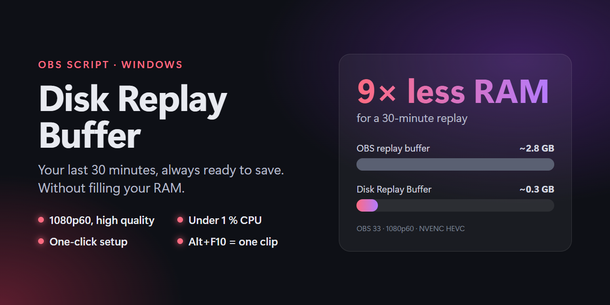

# OBS Disk Replay Buffer

Keeps the last 30 minutes of gameplay in 1080p60, like the OBS replay buffer, but on disk instead of in RAM.
OBS uses about 300 MB RAM and under 1 % CPU. Press **Alt+F10** to save everything since your last save as one video.

Windows only.

## Install

1. Download [replay-buffer.lua](https://github.com/danielzaiser91/obs-disk-replay-buffer/releases/latest/download/replay-buffer.lua).
2. In OBS: **Tools → Scripts → +**, then pick the file.
3. Click **Set up OBS**, then restart OBS.

From then on, OBS starts with Windows and is **always recording**. That recording is the buffer, so leave it on.
Only the last 30 minutes are kept. Press Alt+F10 to save them as a clip to `Videos\Replays`.
While the clip is being saved, a file `Replay … - processing` stands in for it for a few seconds.

## One clip per monitor (optional)

With two monitors, tick **One clip per monitor** in the script settings (**Tools → Scripts**). Then Alt+F10 saves
one clip per monitor, e.g. `Replay … Monitor 1.mp4` and `Replay … Monitor 2.mp4`. Monitors are numbered from left to
right, as Display Capture lists them.

- Your scene is still recorded as before. Each monitor the scene does not show gets its own recording at its own
  resolution, with the same encoder and the same audio. If the scene shows exactly one monitor, that clip gets its
  number; otherwise it keeps the plain name.
- The option takes effect right away while recording, and when the recording starts. The monitors in the scene are
  checked at that moment, so after switching to a scene with other monitors, untick and tick the option again.
- Each extra monitor is one more encode while you play. With NVIDIA HEVC, two 1080p60 encodes need about twice the
  encoder load. If the OBS log reports "Encoding overloaded", choose a faster preset (Settings → Output → Recording).
- The buffer folder needs about 2.5 GB per monitor.

Why separate recordings and not one wide recording cut in two on save: cutting means encoding the whole clip again.
For 30 minutes of two 1080p60 monitors that takes about 19 minutes with 4 CPU threads
(x264 veryfast, measured on a 10 s sample), costs quality, and needs a 3840×1080 canvas, which is just as much
encoding while you play. Separate recordings are joined without encoding again, in seconds, like the normal clip.

## Update

Download [replay-buffer.lua](https://github.com/danielzaiser91/obs-disk-replay-buffer/releases/latest/download/replay-buffer.lua) again, replace the old file with it, then restart OBS.

## Good to know

- Setup changes the recording settings of your current OBS profile. To keep your old settings, create a new profile first (**Profile → New**).
- Normal recordings are now the buffer: anything older than 30 minutes gets deleted. Press Alt+F10 to keep it.
- The buffer lives out of sight in `%LOCALAPPDATA%\obs-disk-replay-buffer\buffer` and uses about 2.5 GB. It is emptied when you stop recording or close OBS.
- With an NVIDIA GPU, setup picks HEVC at high quality. Other GPUs keep your current encoder.
- ffmpeg is downloaded automatically (about 180 MB) to join the pieces into one file.
- To stop OBS from starting with Windows, open `shell:startup` (Win+R) and delete `OBS Replay Buffer.vbs`.
- Keep `replay-buffer.lua` where it is, since OBS loads it from there on every start.
- Change the hotkey under **Settings → Hotkeys → Save replay to disk**. Change the max clip length or clip folder in the script settings.
