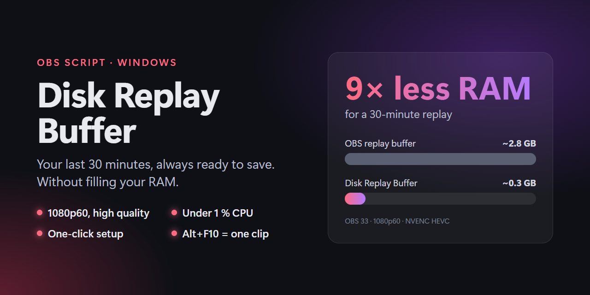

# OBS Disk Replay Buffer

Keeps the last 30 minutes of gameplay in 1080p60, like the OBS replay buffer, but on disk instead of in RAM.
OBS uses about 300 MB RAM and under 1 % CPU. Press **Alt+F10** to save everything since your last save as one video.

Windows only.

## Install

1. Download [replay-buffer.lua](https://github.com/danielzaiser91/obs-disk-replay-buffer/releases/latest/download/replay-buffer.lua).
2. In OBS: **Tools → Scripts → +**, then pick the file.
3. Click **Set up OBS**, then restart OBS.

From then on, OBS starts with Windows and is **always recording**. That recording is the buffer, so leave it on.
Only the last 30 minutes are kept. Press Alt+F10 to save them as a clip to `Videos\Replays`.

## Good to know

- Setup changes the recording settings of your current OBS profile. To keep your old settings, create a new profile first (**Profile → New**).
- Normal recordings are now the buffer: anything older than 30 minutes gets deleted. Press Alt+F10 to keep it.
- The buffer is stored in `Videos\Replays\__temp_folder_for_replay_buffer` and uses about 2.5 GB. Leave it alone: old parts are deleted automatically.
- With an NVIDIA GPU, setup picks HEVC at high quality. Other GPUs keep your current encoder.
- ffmpeg is downloaded automatically (about 180 MB) to join the pieces into one file.
- To stop OBS from starting with Windows, open `shell:startup` (Win+R) and delete `OBS Replay Buffer.vbs`.
- Keep `replay-buffer.lua` where it is, since OBS loads it from there on every start.
- Change the hotkey under **Settings → Hotkeys → Save replay to disk**. Change the buffer length or clip folder in the script settings.
